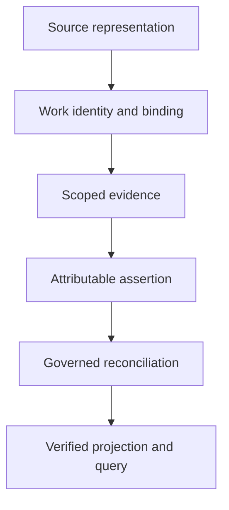

<p align="center">
  
</p>

<h1 align="center">TREK DATA CORE</h1>

<p align="center"><strong>Continuity, with receipts.</strong><br />An evidence-first knowledge and reconciliation workspace for the Star Trek universe.</p>

<p align="center">
  <a href="TREK_RESEARCH_METHOD.md">Research method</a> ·
  <a href="registry/README.md">Registry contract</a> ·
  <a href="TREK_REPO_PROTOCOL.md">Repository protocol</a> ·
  <a href="TREK_ROLE_CATALOG.md">Research roles</a>
</p>

> **Project status — foundation in progress.** Governance, the initial Source/Work/binding contract, a fixture validator, and workspace-startup safety checks are on `main`. Integrated canonical projection, reconciliation, query and coverage implementations remain subject to separate acceptance. Synthetic registry fixtures are **not** accepted Star Trek corpus records.

## The mission

Every claim should have an origin. Every contradiction should remain visible. Every reconciliation should be reproducible.

Trek Data Core aims to connect stories, episodes, films, books, characters, places, technology, timelines and alternate realities into a navigable research graph—without pretending that every source says the same thing. It distinguishes **what a source depicts**, **what a character claims**, **what a researcher infers**, and **what remains unresolved**.

| Principle | What it means here |
| --- | --- |
| **Trace the signal** | Record Source and Work identity, scope, evidence, attribution and provenance. |
| **Preserve the paradox** | Conflicting or unreliable testimony stays visible; interpretation does not erase evidence. |
| **Respect the timeline** | Counterparts, copies, simulations and alternate histories must not silently collapse into one identity. |
| **Reconcile deliberately** | Proposed resolutions are reviewable decisions, not unrecorded model guesses. |
| **Count what was verified** | A title found in an index is not an episode read, reconciled, or independently audited. |

## Research architecture

The intended path from material to a queryable continuity model is deliberately gated:



An assertion is not automatically accepted merely because a source exists. In particular, evidence from a narrator or character is evidence that the statement was made—not necessarily that the statement is true. The [research method](TREK_RESEARCH_METHOD.md) defines how to distinguish observation, interpretation and speculation.

## What works on `main` today

The initial Librarian registry establishes machine-readable shapes for Sources, Works, their evidence-bearing bindings and external crosswalk candidates. Its local validator and tests use synthetic fixture records.

From the repository root, with Python 3:

```bash
python3 tools/validate_librarian_registry.py registry/librarian_registry_fixtures.json
python3 tools/test_librarian_registry.py
python3 -m unittest discover -s tests -p 'test_workspace_startup_safety.py' -v
```

These are **foundation checks**, not a demonstration of an admitted comprehensive database or an operational research service. Before trusting data as accepted, verify the exact contracts, source/binding authority, reconciliations and build receipts—not just a successful command.

| Lane | Accepted `main` state | Next acceptance milestone |
| --- | --- | --- |
| Governance and research method | Present | Keep method and roles aligned with executable rules |
| Librarian Source / Work / bindings | Schema, validator and fixtures present | Stronger schema enforcement and authoritative admission |
| Canonical projection and semantic diff | Development proposals exist | Clean contract convergence, verified inputs and independent review |
| Coverage and research corpus | No comprehensive accepted corpus established | Governed typed coverage and source-binding admission |

Development branches and PRs are **proposals**, even when merged into another development branch. A green proposal CI check does not make its contents accepted `main` state.

## Navigate the archive

| Destination | Purpose |
| --- | --- |
| [Research method](TREK_RESEARCH_METHOD.md) | Sources, uncertainty, contradiction and evidence discipline |
| [Repository protocol](TREK_REPO_PROTOCOL.md) | Authority, acceptance and safe contribution rules |
| [Role catalog](TREK_ROLE_CATALOG.md) | Director, Librarian, Auditor and bounded research responsibilities |
| [Registry](registry/README.md) | Source/Work/binding schema, fixtures and validation |
| [Reconciliation](reconciliation/) | Candidate continuity and consistency work |
| [Proposals](proposals/) | Work awaiting evaluation and explicit acceptance |
| [Chat starters](CHAT_STARTERS.md) | Ready-made paths into specific research questions |

## Contribute without losing provenance

Read [CONTRIBUTING.md](CONTRIBUTING.md), [CLA.md](CLA.md) and the [repository protocol](TREK_REPO_PROTOCOL.md) before proposing material. Prefer verifiable citations, independently attributable analysis and narrow records over bulk transcription. Do not commit complete copyrighted works, extensive copied passages, restricted streams or third-party content without rights.

The repo is **source-visible, not open source**. Original material is proprietary; commercial use, redistribution and hosted services require the permissions described in [LICENSE](LICENSE) and [COMMERCIAL_LICENSE.md](COMMERCIAL_LICENSE.md). Third-party content and trademarks retain their own rights. This is an unofficial research project, not affiliated with or endorsed by Star Trek franchise rights holders.

## Workspace safety

The current source tree removes a previously identified concealed VS Code `folderOpen` task and a JavaScript pseudo-font executable, disables automatic tasks, and includes a source-tree regression check. That does **not** establish that older checkouts, machines, editor extensions or user-level configurations are clean. Do not execute the removed historical payload; see the current source history and startup-safety test for the exact containment scope.

---

<p align="center"><em>Explore boldly. Attribute precisely.</em></p>
