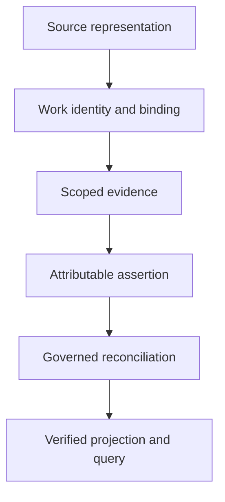

<p align="center">
  
</p>

<h1 align="center">TREK DATA CORE</h1>

<p align="center"><strong>Continuity, with receipts.</strong><br />An evidence-first knowledge and reconciliation workspace for the Star Trek universe.</p>

<p align="center">
  <a href="https://thebrazenbeard.github.io/trek-data-core/">Live Mission Explorer</a> ·
  <a href="TREK_RESEARCH_METHOD.md">Research method</a> ·
  <a href="registry/README.md">Registry contract</a> ·
  <a href="TREK_REPO_PROTOCOL.md">Repository protocol</a> ·
  <a href="TREK_ROLE_CATALOG.md">Research roles</a>
</p>

> **Project status — live Explorer; corpus admission in progress.** The [public Mission Explorer](https://thebrazenbeard.github.io/trek-data-core/) is deployed through GitHub Pages. `main` also includes Source/Work validation, coverage gates and deterministic projection/query tooling. The deployed index has **12 cataloged Missions, 0 admitted Mission Briefings and 0 accepted continuity records**, alongside **190 separately marked, unverified research leads**. Those leads and synthetic fixtures are **not** accepted Star Trek evidence. Publication is manual-only and does not imply evidence review.

## Purpose

Every claim should have an origin. Every contradiction should remain visible. Every reconciliation should be reproducible.

Trek Data Core aims to connect stories, episodes, films, books, characters, places, technology, timelines and alternate realities into a navigable research graph—without pretending that every source says the same thing. It distinguishes **what a source depicts**, **what a character claims**, **what a researcher infers**, and **what remains unresolved**.

| Principle | What it means here |
| --- | --- |
| **Provenance** | Record Source and Work identity, scope, evidence, attribution and provenance. |
| **Conflicting accounts** | Conflicting or unreliable testimony stays visible; interpretation does not erase evidence. |
| **Identity and timelines** | Counterparts, copies, simulations and alternate histories must not silently collapse into one identity. |
| **Reconciliation** | Proposed resolutions are reviewable decisions, not unrecorded model guesses. |
| **Measured coverage** | A title found in an index is not an episode read, reconciled, or independently audited. |

## Mission index: series and episodes

For the human-facing Explorer, a **Mission** means a *Star Trek television series*, and a **Mission Briefing** means an *episode* of that series. Mission Briefings are indexed beneath their parent Mission. These are display labels: the underlying database still stores governed Work types, source identities, evidence and episode relationships.

The following 12 series are in the current display catalog. This is a **series index**, not a claim that every episode has been researched or admitted:

| Mission (series) | Primary indexing focus |
| --- | --- |
| **Star Trek: The Original Series** | Kirk-era Enterprise exploration and its original crew |
| **Star Trek: The Animated Series** | Animated missions of the original Enterprise crew |
| **Star Trek: The Next Generation** | Enterprise-D exploration, diplomacy and scientific encounters |
| **Star Trek: Deep Space Nine** | Station-based stories, interstellar politics and the Dominion conflict |
| **Star Trek: Voyager** | Voyager's journey and discoveries in the Delta Quadrant |
| **Star Trek: Enterprise** | Early Human deep-space exploration before the Federation |
| **Star Trek: Discovery** | The Discovery crew's investigations across different eras |
| **Star Trek: Picard** | Jean-Luc Picard's later life and continuing relationships |
| **Star Trek: Lower Decks** | Support-crew operations and second-contact assignments |
| **Star Trek: Prodigy** | A young crew learning exploration and cooperation |
| **Star Trek: Strange New Worlds** | Pike's Enterprise and its pre-Kirk exploratory voyages |
| **Star Trek: Starfleet Academy** | Cadet training and life within Starfleet Academy |

This roster follows the [official Star Trek series catalog](https://www.startrek.com/series-and-movies). Anthologies such as *Short Treks*, films, books, comics and games require their own explicit Work classifications and links; they are not silently treated as television-series episodes.

## Explore the Mission index

The [live Mission Explorer](https://thebrazenbeard.github.io/trek-data-core/) ([source files](explorer/)) is a dependency-free static interface for browsing the series catalog and searching indexed research. It keeps two kinds of results visibly separate:

| Explorer view | What it contains | Current state |
| --- | --- | --- |
| **Missions / Mission Briefings / continuity records** | A deterministic catalog and only source-bound, reviewed canonical episode and assertion projections | 12 Missions; **0 admitted Briefings** and **0 accepted records** |
| **Research Leads** | Metadata-only episode-title candidates and Wikidata identifiers, with recorded provenance hashes | 190 **unverified** leads across 10 Missions; no accepted coverage effect |

Search the Research Leads to find candidate episode titles or external identifiers, but do not treat their presence as an audited episode list. The separate `explorer/research-leads.json` cannot promote a candidate into a Mission Briefing. The accepted-only `explorer/index.json` requires reviewed projection hashes and evidence-bearing Source↔Work bindings before adding nonfixture records. See the [index contract](docs/EXPLORER_INDEX.md) and [denominator gate](docs/COVERAGE_DENOMINATOR_GATE.md).

To run the Explorer locally, from the repository root:

```bash
python3 -m http.server 8000 --directory explorer
```

Open `http://localhost:8000` in a browser, or use the [public deployment](https://thebrazenbeard.github.io/trek-data-core/). No database server, account, API key or telemetry service is required. Public GitHub Pages publication is intentionally **manual-only**: the workflow checks the five committed Explorer files, regenerates the candidate index and rejects extra or modified files before deployment. The first public release passed these checks in [Actions run #45](https://github.com/thebrazenbeard/trek-data-core/actions/runs/41465590332).

## Data model

This is the intended route from a source record to a queryable continuity model. Each transition has an evidence or acceptance gate:



An assertion is not automatically accepted merely because a source exists. In particular, evidence from a narrator or character is evidence that the statement was made—not necessarily that the statement is true. The [research method](TREK_RESEARCH_METHOD.md) defines how to distinguish observation, interpretation and speculation.

For example, if two episodes give incompatible dates for the same event, the database should preserve both source-backed claims and record any proposed reconciliation separately. It should not silently replace one account with the other.

## Current implementation on `main`

The infrastructure is implemented, but the research corpus is not yet complete. The Librarian contract defines Sources, Works and evidence-bearing bindings; canonical projection, semantic diff, SQLite/PostgreSQL and graph/search builders derive query views from explicitly admitted data. Coverage checks require an accepted Work roster and authoritative source bindings. There are currently **no nonfixture governed records** to project, and the episode denominator remains `DENOMINATOR_UNRESOLVED`.

From the repository root, with Python 3 and Node.js for the browser behavior test:

```bash
python3 tools/validate_librarian_registry.py registry/librarian_registry_fixtures.json
python3 tools/test_librarian_registry.py
python3 tools/validate.py
python3 tools/coverage_ledger.py report
python3 tools/build_research_leads.py --check
python3 -m unittest discover -s tests -p 'test_*.py'
node tests/test_explorer.mjs
```

These checks verify code contracts, deterministic derived files and synthetic cases. They do **not** establish that all Star Trek episodes have been ingested, that a source was watched or read, or that copyrighted source text may be republished.

| Lane | Accepted `main` state | Next acceptance milestone |
| --- | --- | --- |
| Governance and research method | Present | Keep method and roles aligned with executable rules |
| Librarian Source / Work / bindings | Typed schema, validator and synthetic fixtures present | Admit independently checked, nonfixture Source↔Work evidence |
| Canonical projection, semantic diff and query | Deterministic compilers and query adapters on `main`, tested on fixtures and empty projections | Verify a reviewed nonempty projection with approved hash receipts |
| Coverage and episode discovery | Fail-closed coverage ledger; 190 candidate leads; denominator unresolved | Reconcile a rights-valid, independently sourced episode roster and evidence batches |
| Browser Explorer / Pages | [Public Explorer](https://thebrazenbeard.github.io/trek-data-core/) deployed; five verified assets; manual-only guarded updates | Re-release after reviewed index/UI changes, then check the live artifact |
| Literary metadata | Private offline OPF scanner, synthetic tests and rights-safe documentation | Reconcile editions, omnibus/anthology contents and Work identities without uploading ebooks |

Development branches and PRs are **proposals**, even when merged into another development branch. A green proposal CI check does not make its contents accepted `main` state.

## Repository guide

| Destination | Purpose |
| --- | --- |
| [Research method](TREK_RESEARCH_METHOD.md) | Sources, uncertainty, contradiction and evidence discipline |
| [Repository protocol](TREK_REPO_PROTOCOL.md) | Authority, acceptance and safe contribution rules |
| [Role catalog](TREK_ROLE_CATALOG.md) | Director, Librarian, Auditor and bounded research responsibilities |
| [Registry](registry/README.md) | Source/Work/binding schema, fixtures and validation |
| [Live Mission Explorer](https://thebrazenbeard.github.io/trek-data-core/) ([source](explorer/)) | Public searchable Missions and segregated candidate Research Leads |
| [Explorer index contract](docs/EXPLORER_INDEX.md) | Acceptance rules for public Briefings and continuity records |
| [Coverage denominator gate](docs/COVERAGE_DENOMINATOR_GATE.md) | Why a catalog or candidate count is not verified episode coverage |
| [Private OPF intake](docs/LITERARY_OPF_PRIVATE_INTAKE.md) | Metadata-only, nonpublic book/edition inventory workflow |
| [Reconciliation](reconciliation/) | Candidate continuity and consistency work |
| [Proposals](proposals/) | Work awaiting evaluation and explicit acceptance |
| [Chat starters](CHAT_STARTERS.md) | Ready-made paths into specific research questions |

## Contributing

Read [CONTRIBUTING.md](CONTRIBUTING.md), [CLA.md](CLA.md) and the [repository protocol](TREK_REPO_PROTOCOL.md) before proposing material. Prefer verifiable citations, independently attributable analysis and narrow records over bulk transcription. Do not commit complete copyrighted works, extensive copied passages, restricted streams or third-party content without rights.

The repo is **source-visible, not open source**. Original material is proprietary; commercial use, redistribution and hosted services require the permissions described in [LICENSE](LICENSE) and [COMMERCIAL_LICENSE.md](COMMERCIAL_LICENSE.md). Third-party content and trademarks retain their own rights. This is an unofficial research project, not affiliated with or endorsed by Star Trek franchise rights holders.

## Workspace security

The current source tree removes a previously identified concealed VS Code `folderOpen` task and a JavaScript pseudo-font executable, disables automatic tasks, and includes a source-tree regression check. That does **not** establish that older checkouts, machines, editor extensions or user-level configurations are clean. Do not execute the removed historical payload; see the current source history and startup-safety test for the exact containment scope.

