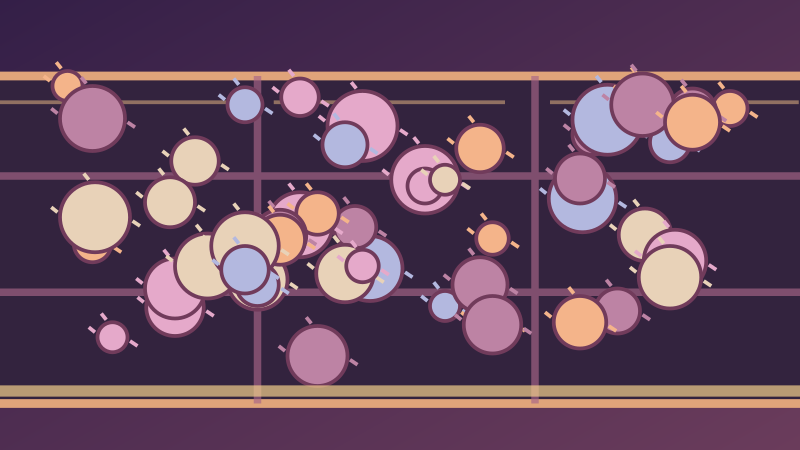
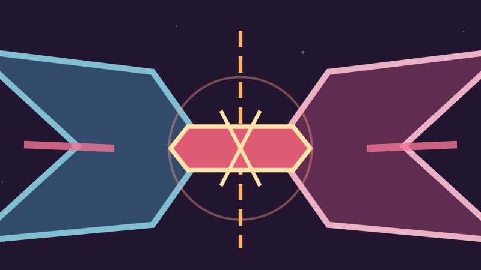
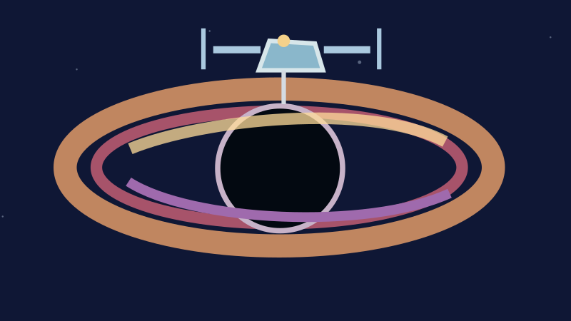

# Pictorial source-motif thumbnails — HELD design review

The live *proposed* Explorer artwork integration [Draft PR #595](https://github.com/thebrazenbeard/trek-data-core/pull/595)
uses 132px mobile and 190px desktop `background-size: contain` slots. Its
800×450 source illustrations include a bottom text/footer strip that uses
approximately **23%** of the graphic's height; at 132px wide, its 13–27 SVG
unit text becomes approximately 2–5 screen pixels high and illegible.
External card titles, source links, accessibility descriptions, and attribution
already exist in that PR. Enlarging the embedded wording duplicates those
labels and further erases pictorial area.

This **isolated art-only successor** derives six text-free, 16:9 motif crops
from the full source-audited originals frozen at commit
`0a14381a01b77966f6c2d1be9b805aaf025d58b4`, the art used by held
[Draft PR #593](https://github.com/thebrazenbeard/trek-data-core/pull/593).
No new objects or depicted events are invented: it removes the source footer
and visible typography, then uniformly zooms the existing art 1.25× from
center. This preserves circular shapes and crops the outer 12.5% of each
side. Existing visual geometries are additionally pinned by six frozen
full-size SVG SHA-256 values to prevent unnoticed scene replacement. More
importantly, **the complete upstream source record for each of the six rows**
is independently digest-pinned here, as are explicit first-party
title/URL/description-cue/source-kind/no-image-rights tuples. A changed source
reference, fake cue digest, rumor source classification, invented rights grant,
or even an unexpected extra metadata key is rejected before a thumbnail or
manifest can be generated. Original pixels alone cannot authenticate their
metadata. These code-local pins are regression controls, not original-source
HTML custody or an assertion of independent source corroboration.
No Explorer JS, CSS, HTML, CI allowlist, or public site is changed here.

## Previews and provenance

Each row is a distinct original motif backed by exact source-local IDs and
the first-party description cues already pinned in the two parent proposals.
The clickable thumbnail is an SVG in this HELD proposal; caption/provenance
must remain *external* to the picture if an integrator later chooses it.

| Source-local ID and original thumbnail | Source-supported motif | First-party evidence |
| --- | --- | --- |
| `lead:0000` —  | Abstract planet-devourer approaching a fragmented world | [Paramount+ *The Doomsday Machine* publisher description](https://www.paramountplus.com/shows/video/1226106142/) |
| `lead:0001` —  | Fuzzy shapes overfill generic compartments | [Paramount+ *The Trouble with Tribbles* publisher description](https://www.paramountplus.com/shows/video/1226188697/) |
| `film:film-2009` —  | Intersecting legacy/future paths | [StarTrek.com *Star Trek (2009)* synopsis](https://www.startrek.com/movies/star-trek-2009) |
| `film:film-nemesis` —  | Mirrored clone/weapon metaphor | [StarTrek.com *Star Trek Nemesis* synopsis](https://www.startrek.com/movies/star-trek-nemesis) |
| `literature:prh-autobiography-janeway` —  | Open memoir with long route | [PRH distributor's *Autobiography of Kathryn Janeway* book description](https://www.penguinrandomhouse.com/books/646637/the-autobiography-of-kathryn-janeway-by-una-mccormack/) |
| `literature:proposed-lit-snw-ring-of-fire` —  | Accretion ring with abstract station above | [Simon & Schuster's *Ring of Fire* book description](https://www.simonandschuster.com/books/Star-Trek-Strange-New-Worlds-Ring-of-Fire/David-Mack/Star-Trek-Strange-New-Worlds/9781668095898) |

The exact row IDs, source URLs, source-cue digests, original full-art SHA-256,
derived thumbnail SHA-256, output filenames, and intended Draft #595
filename crosswalk live in [`manifest.json`](manifest.json). It does **not**
reconcile global Work identity, literary editions or source-image rights.

## Actual 132px / 190px raster checks

All six SVGs were rasterized at **132×74** and **190×107** pixels with Sharp
on 2026-11-05. Each of the six 132px images was inspected individually;
Janeway and Ring of Fire were also inspected individually at 190px. The
original 132px Doomsday and Janeway banners were inspected for before/after
comparison. The pictorial motifs remain identifiable and visibly distinct,
while tiny embedded poster headings and rights disclaimers no longer appear.
The old disclaimers are preserved **as data in this document and manifest**, not
inside unreadable artwork. This is local raster qualification, not browser or
screen-reader qualification of PR #595. Those separate checks remain open.

## Constraints and integration handoff

- Never substitute these six variants solely by matching a visible title.
  The accepted source-local key, medium, exact title, source URL and metadata
  status must agree with Draft #595's independently tested binding function.
- If integrated, add **new allowlisted exact files** and review/re-pin the
  effective Explorer CSS/JS, release validator and cache manifests. The
  current protected crosswire regression tests must continue to pass.
- Keep external visible record title, artwork attribution, linked publisher
  motif source, and accessible `role=img` explanation. CSS backgrounds alone
  cannot carry equivalent accessible text.
- `directory:lead:0050` *Crossfire* in Draft #595 is a **generic abstract
  placeholder**, not an independently sourced episode-specific thematic
  illustration. This proposal does not pretend to upgrade it from its title
  or an unsourced visual guess; that remains an independent source-bound task.
- No screen stills, publisher posters, book jackets, ship likenesses, source
  media bytes or third-party image links are embedded. No film/episode viewing,
  book close reading, accepted Work admission, coverage effect, publication,
  approval to merge, or rights clearance is claimed.

The deterministic generator is `tools/build_thematic_thumbnails.py`;
`--check` verifies all generated bytes. The hostile regression suite is
`tests/test_thematic_thumbnails.py`. The repository's existing full Python,
JavaScript, and release checks remain required before integration.

**Status: HELD, NOT DEPLOYED.** Pending independent art/provenance review and
separate real-browser responsive/screen-reader validation of any future
integration candidate.
